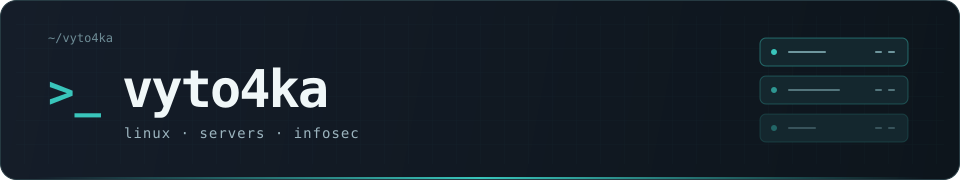

  

  

  

  

<table align="center">
  <tr>
    <th width="200">UPTIME · DAYS</th>
    <th width="200">COMMITS</th>
    <th width="200">VIEWS</th>
  </tr>
  <tr>
    <td align="center"></td>
    <td align="center"></td>
    <td align="center"></td>
  </tr>
</table>
